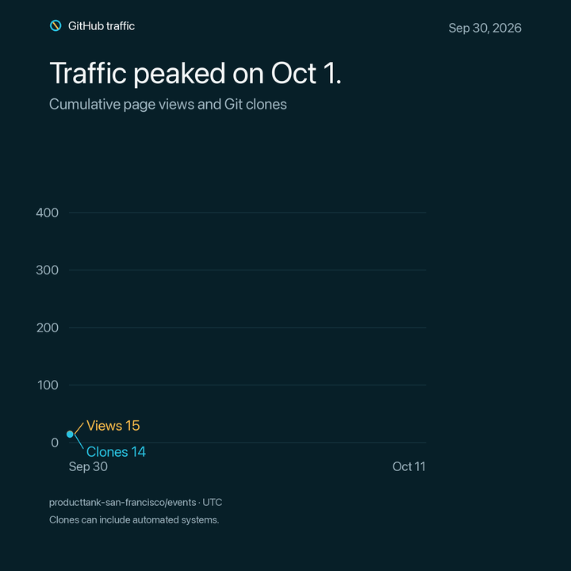

# GitHub traffic: [producttank-san-francisco/events](https://github.com/producttank-san-francisco/events)

> **GitHub counted 83 unique visitors and 327 page views from 2026-09-28 through 2026-10-11.**

GitHub reports a rolling 14-day window. “Unique” means GitHub’s estimate of distinct visitors or clients, not confirmed people.

## Jorge’s page

- **14 unique visitors** opened the page **27 times**.
- It ranked **#3** among the repository pages GitHub returned.
- **This does not show link clicks.** GitHub counts visits to this page, not clicks from it to another site.

## At a glance

| Activity | Total | Unique | Plain-language meaning |
| --- | ---: | ---: | --- |
| Page views | 327 | 83 | Repository pages loaded in a browser |
| Git clones | 124 | 75 | Repository copies requested through Git; automation may be included |

## Most-viewed pages

| Page | Views | Unique visitors |
| --- | ---: | ---: |
| [2026-09-30-ai-workflows-pms-use-every-day](https://github.com/producttank-san-francisco/events/tree/main/2026-09-30-ai-workflows-pms-use-every-day) | 103 | 62 |
| [Repository home](https://github.com/producttank-san-francisco/events) | 45 | 27 |
| [2026-09-30-ai-workflows-pms-use-every-day/jorge-alcantara](https://github.com/producttank-san-francisco/events/tree/main/2026-09-30-ai-workflows-pms-use-every-day/jorge-alcantara) | 27 | 14 |
| [2026-09-30-ai-workflows-pms-use-every-day/tom-alterman](https://github.com/producttank-san-francisco/events/tree/main/2026-09-30-ai-workflows-pms-use-every-day/tom-alterman) | 20 | 9 |
| [2026-09-30-ai-workflows-pms-use-every-day](https://github.com/producttank-san-francisco/events/blob/main/2026-09-30-ai-workflows-pms-use-every-day) | 15 | 10 |
| [2026-09-30-ai-workflows-pms-use-every-day/albert-collell](https://github.com/producttank-san-francisco/events/tree/main/2026-09-30-ai-workflows-pms-use-every-day/albert-collell) | 12 | 11 |
| [2026-09-30-ai-workflows-pms-use-every-day/patterns](https://github.com/producttank-san-francisco/events/tree/main/2026-09-30-ai-workflows-pms-use-every-day/patterns) | 12 | 7 |
| [2026-09-30-ai-workflows-pms-use-every-day/wesley-frederick](https://github.com/producttank-san-francisco/events/tree/main/2026-09-30-ai-workflows-pms-use-every-day/wesley-frederick) | 9 | 6 |
| [2026-09-30-ai-workflows-pms-use-every-day/tom-alterman/slides](https://github.com/producttank-san-francisco/events/tree/main/2026-09-30-ai-workflows-pms-use-every-day/tom-alterman/slides) | 8 | 7 |
| [2026-09-30-ai-workflows-pms-use-every-day/albert-collell/from-ic-to-orchestrator.pdf](https://github.com/producttank-san-francisco/events/blob/main/2026-09-30-ai-workflows-pms-use-every-day/albert-collell/from-ic-to-orchestrator.pdf) | 7 | 7 |

## Where visitors came from

| Referring site | Visits | Unique visitors |
| --- | ---: | ---: |
| [github.com](https://github.com) | 18 | 7 |
| Google | 2 | 2 |
| [linkedin.com](https://linkedin.com) | 1 | 1 |

## Daily activity

Only days with recorded activity are shown.

| Date | Page views | Unique visitors | Clones | Unique cloning clients |
| --- | ---: | ---: | ---: | ---: |
| 2026-09-30 | 15 | 2 | 14 | 7 |
| 2026-10-01 | 147 | 48 | 68 | 39 |
| 2026-10-02 | 84 | 18 | 14 | 10 |
| 2026-10-03 | 31 | 10 | 15 | 11 |
| 2026-10-04 | 8 | 4 | 1 | 1 |
| 2026-10-05 | 31 | 8 | 4 | 3 |
| 2026-10-06 | 3 | 3 | 0 | 0 |
| 2026-10-07 | 6 | 4 | 0 | 0 |
| 2026-10-08 | 1 | 1 | 3 | 2 |
| 2026-10-09 | 1 | 1 | 3 | 1 |
| 2026-10-10 | 0 | 0 | 1 | 1 |
| 2026-10-11 | 0 | 0 | 1 | 1 |

## What these numbers cannot answer

- They do not identify visitors.
- They do not show which outbound links visitors clicked.
- Daily unique counts cannot be added: the same visitor can appear on more than one day.
- Git clones can include automated systems, so they are not the same as people adopting the material.

## Source

GitHub REST API snapshot fetched at 2026-10-12T16:36:55Z. The adjacent JSON file contains the exact API responses used for this report.
