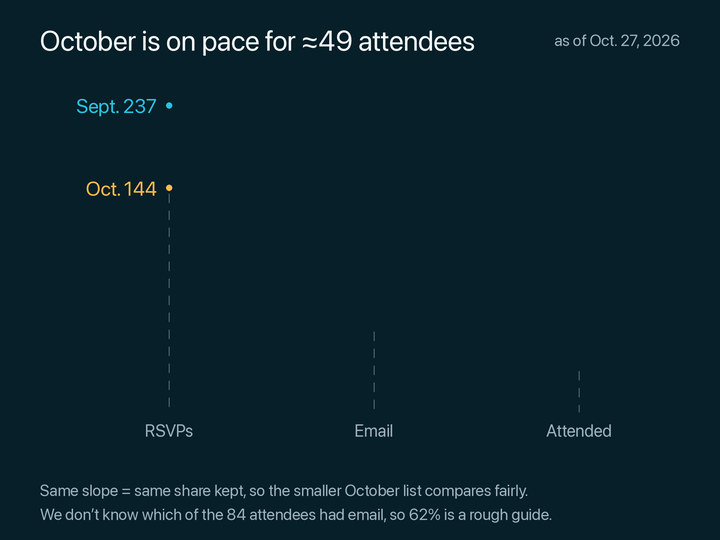
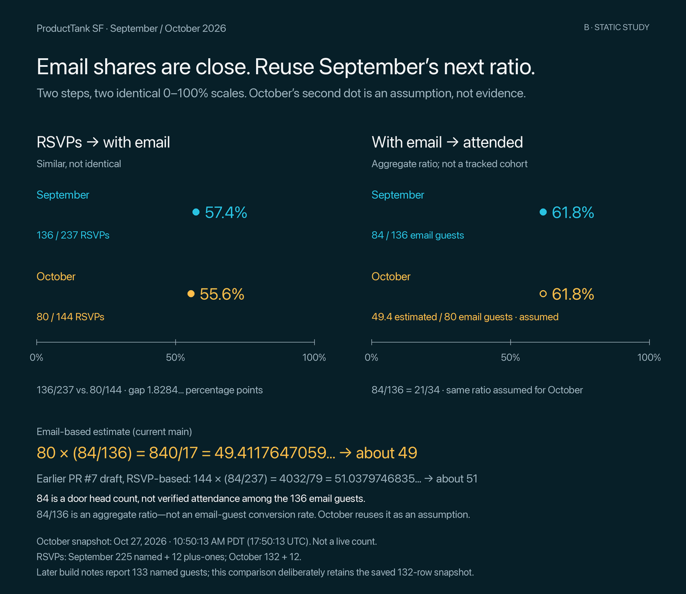
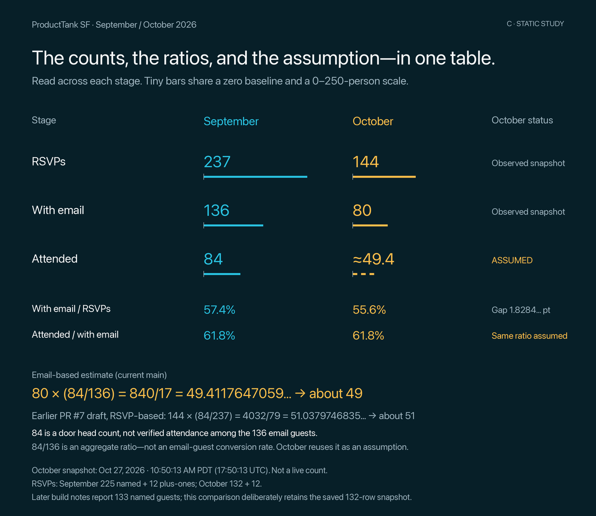

# RSVP attendance: three visual options

## Recommendation

**Option A was selected: the three-stage slopegraph.** Its compact layout follows each month’s counts with less clutter and labels clear of the lines.

Option A is now **720 × 540**, 40% narrower than the original 1200-pixel image, and is animated like the existing slopegraph GIF. B and C remain static 1200 × 1040 comparison images. A leads with its takeaway (“October is on pace for ≈49 attendees”) and a small grey “as of Oct. 27, 2026” at the upper right, names the stages (RSVPs, Email, Attended) in grey on one shared row along the bottom, joins each name to its column’s dots with a faint dashed guide, shows whole-number percentages and ends with two smaller plain-language notes. The brand, study badge, top header row, repeated formulas, axis ticks and long footer were removed from A; exact arithmetic, the full snapshot time and caveats remain below. All options reuse the existing palette and font loader, with direct labels and no legend or gridlines.

## Counts and snapshot

Input: the committed [aggregate counts](../rsvp-slopegraph/stats.json), also shown in the [existing slopegraph report](../rsvp-slopegraph/report.md).

| Stage | September 30, Cribl | October 28, Vapi |
| --- | ---: | ---: |
| Named guests | 225 | 132 |
| Unnamed Meetup plus-ones | 12 | 12 |
| RSVPs: named + plus-ones | 237 | 144 |
| Guests with email | 136 | 80 |
| Attendance | 84, door head count | Unknown; estimated below |

The October input is frozen at **October 27, 2026, 17:50:13 UTC / 10:50:13 a.m. PDT**. It is not the latest live sheet. The October guest-list build notes (in the organizer’s Obsidian vault, not in this repo) report **133 named guests at 12:04:35 p.m. PDT**, still 133 at 12:11:01 p.m. PDT. These mockups deliberately retain 132 named guests, 12 plus-ones and 80 with email from the saved snapshot; they do not mix a later named count with older email data. The build notes’ source snapshots and inclusion rules document the companions and original email accounting. No live Google read was made for these mockups.

## Exact arithmetic

Fractions below are exact. Decimals with an ellipsis continue; headline percentages and count labels are rounded only for reading. Estimates are calculated with the unrounded fractions.

| Quantity | Exact calculation | Decimal for reading |
| --- | --- | --- |
| September email share | 136/237 | 57.383966244725738…% |
| October email share | 80/144 = 5/9 | 55.555555555555555…% |
| September drop, RSVPs → with email | 101/237 | 42.616033755274261…% |
| October drop, RSVPs → with email | 64/144 = 4/9 | 44.444444444444444…% |
| Email-share gap, September minus October | 100 × (136/237 − 5/9) = 1300/711 | 1.828410689170182… percentage points |
| September attendees per guest with email | 84/136 = 21/34 | 61.764705882352941…% |
| Email-based estimate (current main) | 80 × 21/34 = 840/17 | 49.411764705882352… → about **49** |
| RSVP-based estimate (earlier PR #7 draft, 2be0520) | 144 × 84/237 = 4032/79 | 51.037974683544303… → about **51** |
| RSVP-based estimate minus email-based estimate | 4032/79 − 840/17 = 2184/1343 | 1.626209977661950… people |

**“About the same percentage drop” is fair; “the same percentage drop” is not.** October retains a smaller email share by exactly 1300/711 percentage points. B and C show 57.4% and 55.6%; A’s whole-number 57% and 56% still preserve that distinction.

### Why 49 and 51 differ

- **49** scales attendance with the email-guest count: October has 80/136 as many email guests as September.
- **51** scales attendance with all RSVPs: October has 144/237 as many RSVPs as September.
- Since October’s email share is slightly lower, the email-based method yields the lower estimate. They would agree if the email shares were identical.
- **PR #7 history:** an [earlier draft, `2be0520`](https://github.com/producttank-san-francisco/events/blob/2be052039587a2ab31c8cf2c3eb689effe548d6d/src/rsvp-slopegraph/src/rsvp_slopegraph.py), used the RSVP-based calculation `144 × 84/237`, yielding **about 51**. PR #7’s [merged head, `dc44c7f`](https://github.com/producttank-san-francisco/events/blob/dc44c7f/src/rsvp-slopegraph/src/rsvp_slopegraph.py), switched to the email-based calculation `80 × 84/136`, yielding **about 49**. Current main uses that email-based estimate, as described in the [renderer instructions](../../../src/rsvp-slopegraph/README.md#update-the-numbers). This report keeps both formulas to explain the difference.

## Assumptions and limits

1. **84/136 is a ratio, not a measured conversion rate.** The 84 attendees are a door head count and may include people without email. We have not identified a cohort of 136 email guests and verified which 84 attended. An arrow between these aggregate counts must not imply that evidence exists.
2. **October repeats September’s aggregate attendance-to-email ratio by assumption.** Similar email shares do not establish similar attendance. Different venues, event content, registration timing or attendee mix could change the result. No uncertainty interval is supported by these counts alone; 49.4 is arithmetic precision, not predictive certainty.
3. **RSVPs include unnamed companions.** The plus-ones are outside the named rows. Missing email does not mean a person was rejected or did not attend.
4. **This is a running October snapshot against a completed September event.** It is not a final October registration count.

## Option A — log-scale three-stage slopegraph



The [final frame as a still PNG](option-a-log-scale-three-stage-slopegraph.png) is also written for documents that cannot show GIFs.

**What a viewer gets in five seconds:** both months lose a similar proportion between RSVPs and email guests; extending October with September’s next ratio gives about 49 attendees. Counts remain visible throughout.

**Organizing principle:** follow each month left to right. Equally spaced stages and one shared logarithmic count mapping make equal proportional changes parallel; no points are nudged away from their values.

**Honesty risks:** a log scale is unfamiliar and has no zero. Equal visual distances mean equal multipliers, not equal numbers of people. The chart says this plainly (“same slope = same share kept”) instead of naming the scale, and labels every count directly; it does not need a count axis. The first steps are nearly, not exactly, parallel. The whole-percent labels 57% and 56% still show that difference; its exact size is in the arithmetic table above. A three-stage line can suggest a tracked group, so the chart says we don’t know which of the 84 attendees had email, making 62% a rough guide. Dashed October attendance, its hollow endpoint and the orange “assumed” under ≈49 mark the assumption. The endpoint is plotted at the unrounded 840/17 and labeled approximately 49.

**Animation:** built with the existing GIF’s exact timing: 25 fps, a 0.4-second opening pause, 90 eased steps with October starting slightly after September, an 0.08-of-the-reveal fade for each label, then a 2.84-second hold on the last frame. Total 6.92 seconds, played once, matching the existing slopegraph GIF. Left labels, stage names, title, date and notes stay visible throughout. Each line’s middle count and first percentage fade in when it reaches the Email column; its end count, second percentage and “assumed” fade in when it reaches Attended. Labels never move, so every frame keeps the same clearance as the still.

## Option B — two step-ratio panels



**What a viewer gets in five seconds:** 57.4% and 55.6% are close, not identical; 61.8% is then assumed for October, producing about 49. The measured comparison and borrowed assumption occupy separate panels.

**Organizing principle:** compare ratios rather than infer them from line angles. Both panels have the same pixel width and the same complete 0–100% scale. Rows and dots have direct month, count and percentage labels. The hollow October dot says “assumed.”

**Honesty risks:** the 1.8284…-point difference is visually small on a full scale; the exact fractions and gap are printed below the panel rather than amplified with a cropped axis. Two aligned 61.8% dots could imply independent confirmation, so the October label and subtitle explicitly say otherwise. The second panel’s heading is not evidence of cohort tracking; the aggregate-ratio caveat remains visible. Absolute event sizes are less immediate than in A or C, though the numerator/denominator labels retain them.

**Effort to animate like the existing GIF:** medium. Keep axes and labels in place, reveal the measured left-panel dots, reveal September’s right-panel dot, then introduce October’s hollow assumed dot and the formula. It needs dot-reveal choreography rather than reusing the existing slopegraph motion unchanged. Do not present the assumed dot as a second observation, or animate a percentage label independently from its numerator and denominator. No animation has been implemented.

## Option C — counts-and-ratios table-graphic



**What a viewer gets in five seconds:** all source counts and the estimated cell are easy to locate; the two ratio rows explain the comparison without decoding a graph.

**Organizing principle:** scan stage rows and month columns. Inline bars have identical 0–250-person mappings and visible zero starts. The estimate cell is marked “ASSUMED,” uses an approximate number, and has a dashed bar. Ratio rows use the same month columns as the counts.

**Honesty risks:** the inline bars show absolute counts, not percentage changes; the viewer must read the ratio rows to see the argument. There is no log-scale trick, but it is denser and less sequential than B. A precise decimal in a table can look more certain than the prediction warrants; the approximation sign, assumption label and footer distinguish calculation from observation.

**Effort to animate like the existing GIF:** low to medium. The table layout is static; reveal the observed rows first, then the ratio rows and estimated cell. The current palette, font and GIF encoding can be reused, but row and bar reveals need new drawing logic. Keep count labels stable rather than counting through invented intermediate observations. No animation has been implemented.

## Reproduce and verification

Requires Python 3, Pillow and Gifski, as well as this repository’s existing renderer modules. From the repository root:

```sh
python3 -B docs/reports/rsvp-attendance-funnel-visual-options/render_options.py
```

The [render script](render_options.py) reads the saved stats, imports the existing palette, font loader and animation timing, uses exact rational arithmetic until drawing, and writes only the three PNGs and Option A’s GIF beside itself. It does not update the source report, stats, GIF or Google Sheet. Layout and copy are mockups for this snapshot, not a hardened general-purpose chart API.

Verification performed: ran the renderer and opened a contact sheet of eight A animation frames, from the opening pause to the final hold. A rendered at 720 × 540; all 18 text labels passed the render-time check for at least six pixels of clearance from all four full line segments and all three dashed guides, with no text overlaps. Text bounds also passed the canvas-edge check on every frame. The final GIF frame matches the still PNG within GIF color quantization. Read back from the files, the A GIF and the existing slopegraph GIF both total 6.92 seconds, open with a 400 ms frame, end with a 2,840 ms hold and have no loop flag. B and C still rendered at 1200 × 1040. No test suite was run, as requested. No device-specific display check is claimed.

## Selected design

**Option A was selected** because following each month’s count path makes the similar proportional drops and the assumed October extension easy to compare. The narrow layout leads with the takeaway; stable direct labels, shared stage guides and plain-language caveats keep the chart compact without hiding counts or uncertainty. Animation reveals each step and its labels together, then holds on the final still. B and C remain as the alternatives considered, not open choices. Both attendance formulas and the complete snapshot caveats remain in this report rather than on the compact chart.
