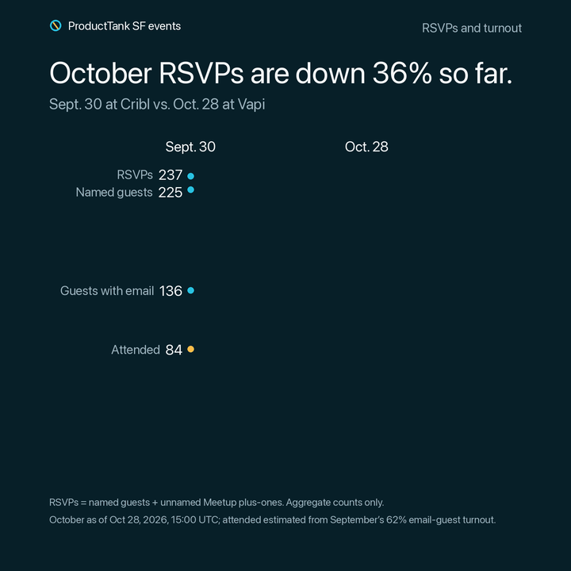

# ProductTank SF: September vs. October RSVPs

> **October RSVPs are down 39% so far.** Sept. 30 at Cribl drew 237 RSVPs; Oct. 28 at Vapi has 144 so far.

| Stat | Sept. 30 | Oct. 28 |
| --- | ---: | ---: |
| RSVPs | 237 | 144 |
| Named guests | 225 | 132 |
| Guests with email | 136 | 80 |
| Attended | 84 | ~49 (estimate) |

- RSVPs are named guests plus unnamed Meetup plus-ones.
- September attended is the door head count.
- October as of Oct 27, 2026, 17:50 UTC; attended estimated from September’s 62% email-guest turnout.
- Aggregate counts only. No guest names or emails are stored in this repository.

To refresh, edit [`stats.json`](stats.json), then run `./src/rsvp-slopegraph/src/rsvp_slopegraph.py` from the repository root.
